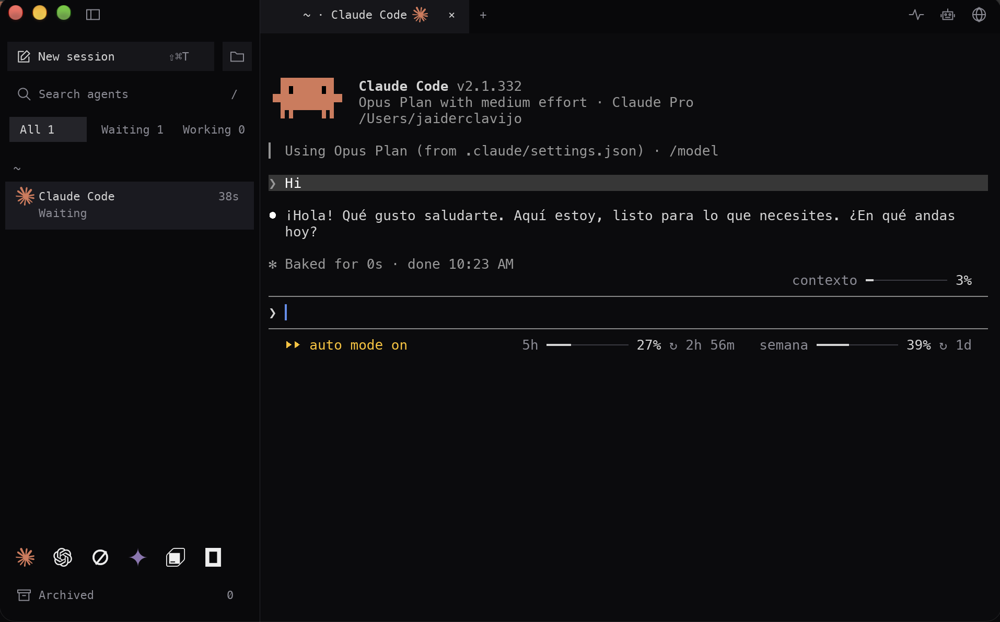
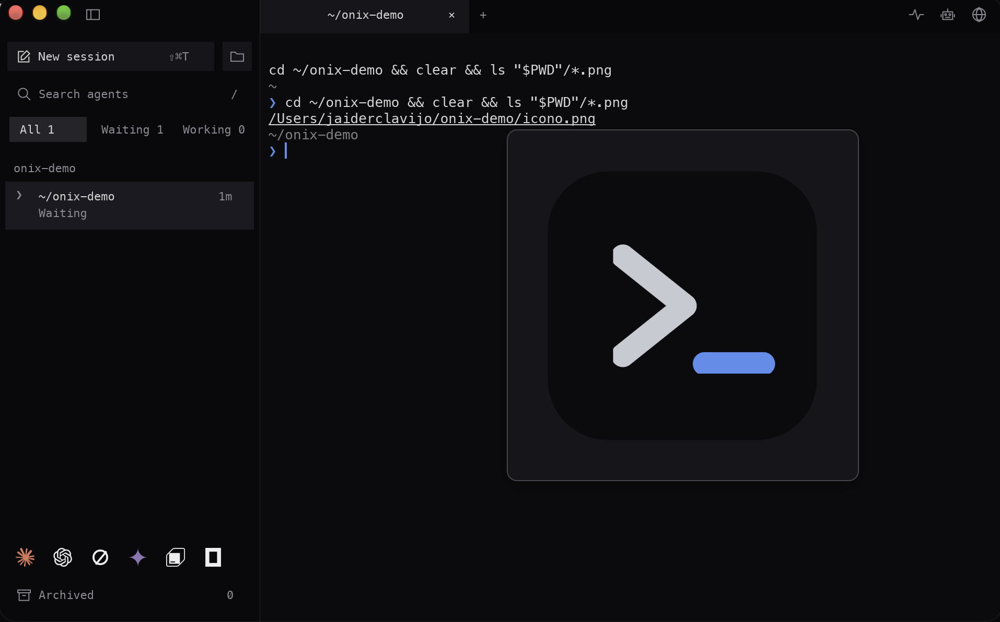

# Ónix

Ónix es una terminal para macOS escrita en Rust, pensada para trabajar con agentes de código como Claude Code. Es liviana, tiene tema oscuro y no envía telemetría ni se conecta a la red por su cuenta. Los programas que ejecutes dentro sí pueden hacerlo.

En mediciones del 25 de noviembre de 2026, con la ventana a pantalla completa en un Mac Retina, usó entre 56 y 89 MB de memoria.



## Instalación

Necesitas macOS y [Rust](https://rustup.rs). La primera compilación descarga las dependencias.

```bash
git clone https://github.com/ClavijoJaider/Onix.git
cd Onix
scripts/build-app.sh
```

La app queda en `~/Applications/Onix.app`. El resultado de la compilación se guarda en `~/Library/Logs/mi-terminal-build.log`.

## Imágenes, archivos y rutas



Cuando en la terminal aparece la ruta de un archivo o carpeta que existe, Ónix la reconoce. Sirven las rutas completas, las que empiezan por `~/`, las `file://` y las relativas a la carpeta actual. Las direcciones web no se abren con clic.

| Acción | Resultado |
|---|---|
| Pasar el ratón sobre una imagen o documento | La subraya y muestra una vista previa flotante |
| Clic en una ruta | La muestra en el Finder |
| ⌘ clic en una imagen | La abre en Vista Previa |
| ⌘ clic en un documento | Lo abre con su app |
| Arrastrar un archivo a la ventana | Escribe su ruta, lista para usar en el shell |
| ⌘V con una imagen en el portapapeles | La guarda como PNG y pega su ruta |

La vista previa funciona con imágenes (PNG, JPG, GIF, WebP, HEIC, BMP y TIFF) y con PDF, Word, Excel, PowerPoint, Pages, Numbers, Keynote, texto, Markdown, CSV, MP4 y MOV.

En Claude Code, las marcas `[Image #1]` de las imágenes que pegas se pintan de naranja. Puedes verlas al pasar el ratón y abrirlas igual que cualquier otra imagen.

## Claude Code dentro de Ónix

Ónix ajusta cómo se ve Claude Code sin cambiar lo que el programa envía ni lo que copias:

- Muestra el consumo de contexto como una barra fina en el pie, junto al uso, y en cada sesión de la barra lateral. Cambia de color al llegar al 60 % y al 80 %.
- Separa tus mensajes con un bloque y encierra el cuadro de escritura en un marco redondeado.
- Junta la línea de uso con la línea del modo (por ejemplo "auto mode on") cuando caben en la misma fila.
- Oculta la ayuda "(shift+tab to cycle)" y el nombre de sesión repetido sobre el cuadro de escritura.
- Mantiene el cuadro de escritura abajo cuando se cierra un diálogo.
- Limpia el historial de la pantalla después de `/clear`.
- Dibuja las líneas, bloques y símbolos de su interfaz para que encajen bien en la cuadrícula.

## Pestañas y paneles

Cada pestaña admite hasta dos paneles lado a lado. El separador se arrastra con el ratón y con doble clic vuelve a la mitad. El título muestra la carpeta y el agente que está corriendo, y si es largo se desplaza al pasar el ratón.

Al hacer clic en otra posición de la línea que estás escribiendo, el cursor se mueve hasta allí. Si subiste en el historial, el botón "Jump to bottom" te devuelve al final. Cuando un programa usa el ratón, mantén Shift para seleccionar texto.

La app recuerda el tamaño y la posición de la ventana, y al abrirla vuelven tus pestañas. Si tu zsh no tiene un tema propio, Ónix muestra la carpeta en una línea y el cursor debajo.

## Barra lateral

Agrupa tus sesiones por proyecto y muestra el estado de cada una y hace cuánto cambió. Puedes filtrarlas por "All", "Waiting" o "Working" y buscarlas con `/`. Desde ahí también se crea una sesión nueva o se elige una carpeta.

Los íconos de abajo lanzan en la carpeta actual los agentes que tengas instalados: Claude Code, Codex, Antigravity, Grok, opencode y Junie. Cada uno se instala aparte y usa tu propia cuenta.

Las pestañas con agente que cierres pasan a "Archived". Un clic las reabre y la × las quita de la lista, sin borrar los archivos del agente. Claude Code retoma la sesión exacta; en los demás agentes depende de lo que permita cada uno.

Un chat de Claude Code en una pestaña oculta que lleve 15 minutos esperando, sin tareas pendientes ni texto a medio escribir, se duerme para liberar memoria. Se retoma con Enter.

## Agentes, procesos y consumo

La lista de agentes (⇧⌘A) muestra los que están abiertos. Con las flechas eliges uno, con Enter vas a él y con `s` dos veces le envías Ctrl+C.

La lista de procesos (⇧⌘P) muestra CPU, memoria y puertos en escucha. Puedes escribir para filtrar, ordenar con Tab y saltar al panel de un proceso con Enter. Para detener uno de tus procesos, pulsa ⌘⌫ y confirma con Enter.

El botón del mundo (⇧⌘L) lista los puertos que tus programas tienen en escucha, con el proceso de cada uno. Con Enter o un clic se abre en el navegador, ⌘C copia la dirección y Tab salta a su terminal. Para detenerlo, pulsa ⌘⌫ y Enter, o haz dos clics en la ×.

Las listas de agentes, procesos y puertos se pueden abrir a la vez, una debajo de otra. El teclado va a la última que abriste o tocaste.

### Semáforo de agentes

La barra lateral y la lista de agentes dicen cómo va cada uno con un punto que late: ámbar si espera tu respuesta o un permiso, azul mientras trabaja y verde si terminó y aún no lo has visto. Con ⌘J saltas al que te necesita. Si no lo estás mirando, Ónix te avisa con una notificación.

Con Claude Code, Ónix lee el estado que él mismo anota en `~/.claude/sessions`. Con los demás reconoce en pantalla los menús numerados y las preguntas de sí o no. No guarda ese texto.

## Paleta de comandos

Con ⌘K escribes lo que quieres hacer: ir a una pestaña, abrir un panel, lanzar un agente o retomar una sesión archivada. Eliges con las flechas y Enter, o con un clic. Esc la cierra.

El panel "Agent usage" (⇧⌘U) muestra tokens por día y por modelo, tareas, tiempo y un mapa de las horas de más actividad, para 7, 30 o 90 días o todo el historial. Lee las conversaciones y el resumen de Claude Code (`~/.claude`) y las sesiones de Codex (`~/.codex`); al dar clic en un agente muestra solo su uso. En los días que vienen del resumen, el reparto entre entrada y salida es aproximado.

En las sesiones de Claude Code, los puntos al final del cuadro de escritura abren la lista de skills para activarlas con un clic, y cada tarjeta de la barra lateral muestra las cargadas.

## Plugins de la línea de estado

Son opcionales, necesitan `python3` y se encuentran en [`plugins`](plugins/README.md).

| Plugin | Qué muestra |
|---|---|
| `contexto` | Porcentaje de contexto consumido en la sesión |
| `week` | Uso de las últimas 5 horas y de la semana, con el tiempo para reiniciarse. También pone el nombre de la sesión en la pestaña |

Para activarlos, agrega esto a `~/.claude/settings.json` y cambia la ruta por la carpeta donde clonaste el proyecto:

```json
"statusLine": { "type": "command", "command": "python3 ~/Onix/plugins/statusline.py" }
```

Para crear otro plugin, añade una carpeta en `plugins` con un archivo `linea.py` que lea el JSON de Claude Code e imprima su texto. Los plugins se unen en orden alfabético.

## Atajos

| Atajo | Acción |
|---|---|
| ⌘K | Paleta de comandos |
| ⌘J | Ir al agente que te necesita |
| ⌘T | Pestaña nueva |
| ⇧⌘O | Elegir una carpeta |
| ⌘W | Cerrar el panel actual |
| ⌘1 a ⌘9 | Ir a una pestaña |
| ⌃Tab | Pestaña siguiente |
| ⌘D | Dividir en dos paneles |
| ⌘[ o ⌘] | Cambiar de panel |
| ⌘B | Mostrar u ocultar la barra lateral |
| ⇧⌘A | Lista de agentes |
| ⇧⌘P | Lista de procesos |
| ⇧⌘L | Puertos abiertos |
| ⌘F | Buscar en el historial (⏎ anterior, ⇧⏎ siguiente) |
| ⌘+ ⌘− ⌘0 | Agrandar, achicar o restablecer la letra |
| ⇧⌘U | Panel "Agent usage" (se cierra con Esc) |
| ⌘C y ⌘V | Copiar y pegar |
| ⌘A | Seleccionar solo lo que estás escribiendo, para copiarlo con ⌘C |
| ⌘Z | Deshacer lo recién pegado o escrito (zsh y Claude Code) |
| ⇧RePág y ⇧AvPág | Recorrer el historial |

## Tus datos

Ónix lee los archivos de Claude Code para mostrar las sesiones, las imágenes pegadas y las cifras de uso, sin modificarlos. Sus datos quedan en `~/Library/Application Support/mi-terminal` y las imágenes temporales en `~/Library/Caches/mi-terminal`.

## Desarrollo

```bash
cargo test
cargo run --release -p usage -- --days 30
```

El segundo comando imprime tu consumo de tokens de los últimos 30 días.

El código está dividido en tres partes:

- `crates/app`: la ventana, la interfaz y el dibujo en CPU.
- `crates/term-core`: la conexión con el shell y la emulación de terminal.
- `crates/usage`: la lectura y el conteo del uso.

## Logos

Los logos de los agentes pertenecen a sus dueños. Su origen está en [ARCHIVO-FUENTES.md](crates/app/assets/icons/ARCHIVO-FUENTES.md).
